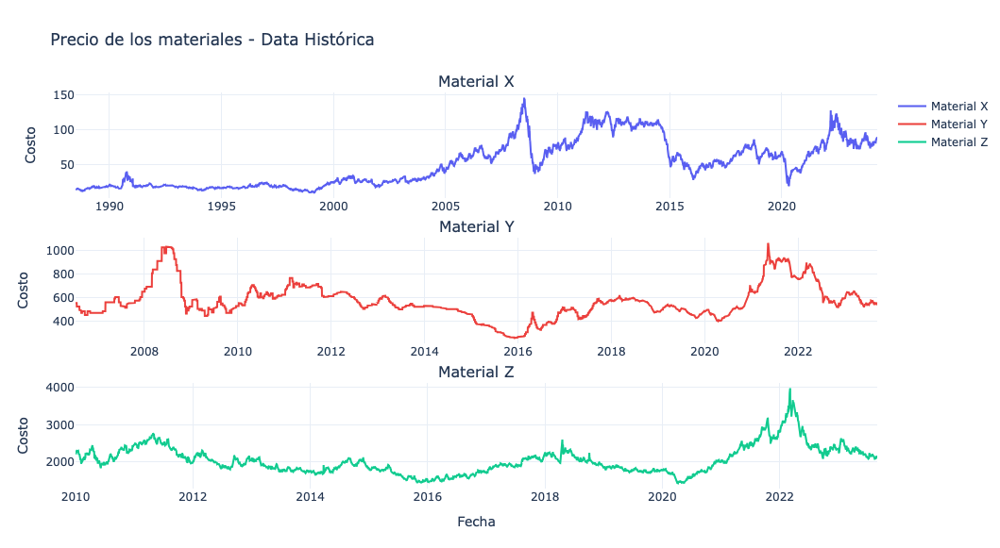
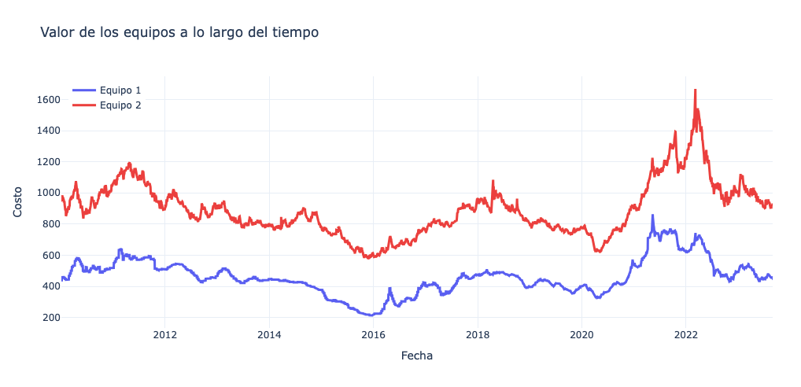
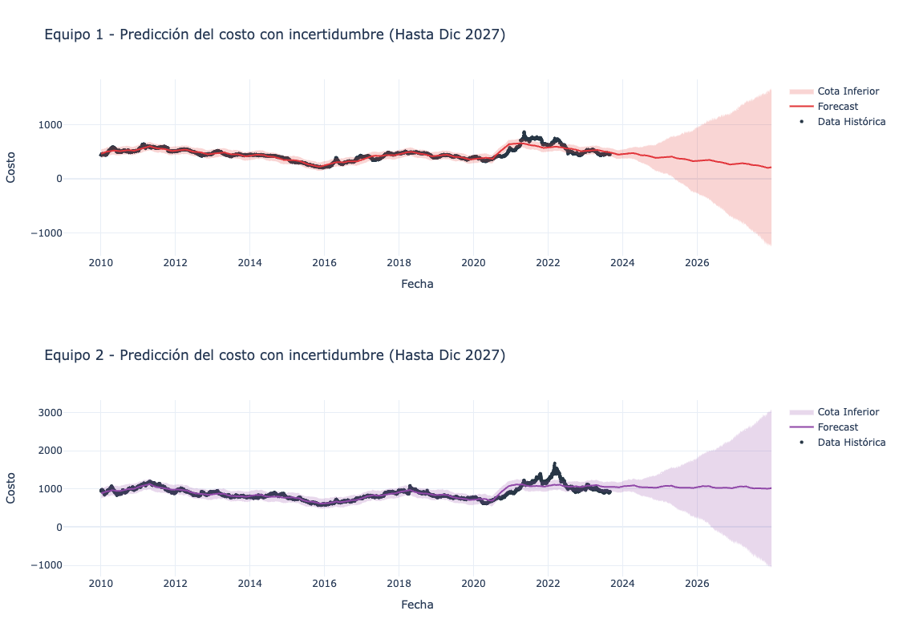
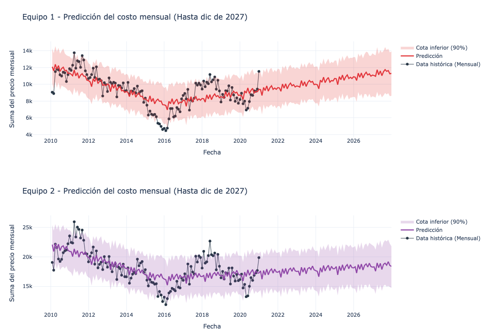

# Prueba Técnica Científico de datos DataKnow - Caso 1 - 
## Carolina Rojas Duque - 19 de octubre de 2025
## Explicación del caso

El caso de estudio plantea el objetivo de estimar los costos asociados a la adquisición de dos equipos de construcción para un proyecto de 36 meses de duración. Para dicha estimación, se propone el uso de unos precios base calculados a partir de los precios de los materiales X, Y y Z que componen los equipos. Se cuenta con las series de tiempo de los costos de dichos materiales a lo largo de los años, con lo que se propone realizar predicciones del costo de los equipos mencionados.

Los objetivos del presente estudio giran en torno a la estimación precisa del precio total, a fin de garantizar un presupuesto financiero confiable del proyecto.

## Supuestos

La descripción suministrada del caso deja algunas cuestiones sobre las que deben realizarse supuestos. Entre estos está el precio de los equipos en los tres años, donde se asume que este se da por arriendo diario de los equipos y, por tanto, debe ser calculado como la suma del precio base diario de dichos equipos, en contraste con otras alternativas como promedios mensuales o un solo pago fijo para los tres años.

Además, se asume que los años de ejecución pensados para el proyecto son 2025, 2026 y 2027, a fin de acotar la exploración de la predicción para años diferentes a estos.

Una última suposición es considerar como entregable final del problema el informe con los costos estimados, lo que apunta a la no necesidad de disponibilizar servicios de predicción de series de tiempo o preparar un codebase para la automatización o recepción de otras series de tiempo para ejercicios de similar índole. Es decir, no hubo necesidad de disponibilizar endpoints ni dejar automatizados pipelines de limpieza de datos, de modo que se puedan correr inmediatamente otros casos similares en el futuro.

## Formas para resolver el caso y la opción tomada en esta prueba

Dado que se requiere hacer un pronóstico del costo de los equipos para los siguientes 3 años, el problema apunta al uso de modelos de forecasting para predecir el costo en el futuro, dados los costos históricos disponibles. Para este fin, una aproximación viable al problema es pronosticar los valores de los materiales X, Y y Z en los años requeridos y, posteriormente, usar estas estimaciones para calcular el valor de los equipos. Esta aproximación puede resultar más completa, dado que permite el análisis de los costos individuales de los materiales. Sin embargo, en caso de que dichas estimaciones presenten incertidumbres elevadas de forma independiente, su uso en las fórmulas para los precios base compondría las incertidumbres, obteniendo una incertidumbre final más elevada.

Por tal motivo, y en aras de priorizar la precisión del costo final, se opta por realizar el forecasting del precio base directo de los equipos 1 y 2, dado que se cuenta con datos históricos suficientes de los tres materiales, coincidentes en fechas y rangos de tiempo, para su cálculo.
Sobre el forecasting, aproximaciones iniciales basadas en estadísticas sencillas como el promedio y la desviación estándar de los datos resultan idóneas como primer paso en estos casos y, solo después, la exploración de modelos estadísticos y de aprendizaje de máquina, en la medida en que el problema lo requiera. Sin embargo, aquí se opta por presentar directamente una alternativa más compleja y robusta, en aras de mostrar las posibilidades técnicas que permite el caso de estudio.

Alrededor de este, existen varios modelos en el estado del arte para la realización de estos pronósticos, entre los que se destacan SARIMA, que utiliza estimación de tendencias y estacionalidades desde la estadística clásica, o modelos de Machine Learning como LSTM (Long Short-Term Memory) o XGBoost, que aprenden el comportamiento de los datos respecto a valores anteriores para la estimación de los valores futuros. Se decide finalmente presentar una primera aproximación al problema usando el framework Prophet, que permite modelar tendencias, estacionalidad y puntos de cambio de forma robusta y completa, con una implementación sencilla, lista para usar, y que da buenos insumos para una primera exploración.

Finalmente, sobre la metodología para el manejo del muestreo de datos, inicialmente se explora la posibilidad de hacer el ajuste del modelo y la predicción usando muestras en la escala de días. Sin embargo, debido a la cantidad de muestras disponibles y la necesidad de una escala de tiempo amplia en la predicción futura (3 años, que corresponden a 1095 días), también se contempla la posibilidad de agrupar las series de tiempo en meses y realizar la predicción en esta escala, alternativa que finalmente presenta los mejores resultados.

## Resultados del análisis de los datos y los modelos

Se comienza por realizar un análisis exploratorio de los datos (EDA), que inicia con su debido preprocesamiento y estandarización. Con este fin, los datos crudos iniciales se almacenan en una carpeta dedicada (data/raw), y su versión limpia en una carpeta correspondiente (data/processed) para su posterior uso. Se verifica además la calidad de los datos, observando la cantidad de datos null, que en todos los casos es cero.

Se procede entonces a graficar las series de tiempo de los tres materiales:

 

Se observa que los tres materiales tienen muestreos en la escala de días, abarcando una buena cantidad de años, y que presentan comportamientos con picos y zonas de no linealidad, así como estacionalidades no concluyentes. Además, se observa un comportamiento diferencial durante la pandemia por COVID-19, entre 2020 y 2022.

Se observa que el rango de fechas común para los tres materiales es entre 2010 y 2023, teniendo un total de 3530 fechas coincidentes en sus muestreos, lo que permite el cálculo de los precios base históricos de los equipos en dichas fechas. Dichos datos históricos se presentan a continuación:

Dados los comportamientos irregulares de las series de tiempo, y buscando la mayor precisión en las estimaciones de los costos, se opta por realizar el forecasting directamente sobre las series de tiempo de los equipos.

Una primera aproximación al problema, usando la librería Prophet previamente mencionada, arroja los siguientes resultados al utilizar los muestreos en la escala de días para el ajuste de los modelos y la predicción en la ventana de tiempo requerida:

Dichas gráficas presentan incertidumbres con comportamientos que explotan o que son exponenciales a medida que el tiempo de pronóstico es mayor. Si bien esto es esperable de los modelos de forecasting, se decide realizar esfuerzos para la disminución de la incertidumbre dados sus altísimos valores (la cota inferior de los costos llega a rozar valores negativos). Dichos esfuerzos se concentran en la mejora de la calidad de datos para el ajuste, descartando el intervalo atípico identificado previamente debido a la pandemia, y agregando el muestreo a una escala de meses. Como se dijo en la sección de **Supuestos**, dicha agregación se realiza **sumando** los precios diarios de los equipos, asumiendo que dicha operación corresponde al sistema de costeo usado para la estimación.

El forecasting obtenido se presenta a continuación:

En este caso observamos una incertidumbre acotada en el tiempo y un comportamiento más acorde con las expectativas preliminares (ligeramente creciente). Dada esta mayor certeza, procedemos a calcular con estos valores los costos estimados año por año y para los 3 años del proyecto, en sus casos base, peor escenario y mejor escenario posible. Los resultados obtenidos son:

**Equipo 1 - Total 3 años (2025-2027):**

Escenario Base: $398,237.80

Escenario Optimista (menor costo): $309,725.27

Escenario Pesimista (mayor costo): $486,177.13

**Equipo 2 - Total 3 años (2025-2027):**

Escenario Base: $659,765.24

Escenario Optimista (menor costo): $531,410.41

Escenario Pesimista (mayor costo): $786,732.04

Estos valores pueden ser suministrados como estimaciones iniciales al equipo financiero para la realización de presupuestos y su corroboración contra sus experiencias previas con proyectos anteriores.

Nota: En el notebook de forecasting, se presentan los valores calculados para cada uno de los años si se quieren ser consultados o para una revisión más profunda de la solución presentada. Solo se presentan los valores calculados para los 3 años con el fin de presentar un informe más organizado, limpio y que no sea de gran extensión.

## Futuros ajustes o mejoras

Debido al tiempo acotado para la realización de la prueba, hay una gran cantidad de ajustes y espacio para siguientes implementaciones y mejoras.

De cara al EDA, en el tratamiento de series de tiempo es típicamente adecuado realizar no solo las gráficas de dichas series, sino calcular sus correlaciones con las otras series para evaluar posibles relaciones y redundancias internas, así como análisis de estacionalidad y autocorrelación para mejorar la elección de los modelos de forecasting a utilizar. Habría sido mejor también analizar las series de tiempo submuestreadas mensualmente y entender su comportamiento y posibles estacionalidades adicionales.

Definitivamente en el forecasting también queda mucho trabajo pendiente. Como mencioné previamente, resulta idóneo atacar el problema iniciando con un modelo base hecho solo con promedios de datos para entender la naturaleza y tener estimaciones iniciales para comparar. En cuanto a Prophet, resulta idóneo explorar otras posibilidades como el uso de regresores por pandemia, el uso de estacionalidades customizadas de acuerdo con los análisis adicionales, y explorar más a profundidad los intervalos de tiempo a predecir. Y definitivamente trabajar con su evaluación sobre los datos, dividiendo los datos en train y test, y calculando métricas como el RMSE para entender a mayor profundidad su desempeño con los datos suministrados. Y para poderlo comparar con otros modelos con mayor robustez y más capacidades de flexibilizar y ajustar parámetros como SARIMA desde la estadística, o modelos regresores de Machine Learning que puedan aprender comportamientos más complejos de las series de tiempo. Todo esto con el debido tiempo, con las debidas evaluaciones sobre los datos suministrados, etc.

Finalmente, vale la pena mencionar que también debería explorarse la posibilidad de trabajar forecastings con las series de tiempo de los materiales directamente, pudiendo así utilizar más rango de tiempo histórico (en el caso de X tenemos datos desde 1988, por ejemplo), a fin de explorar si estos datos adicionales permiten realizar pronósticos más precisos y explotar todas las posibilidades que esos datos nos puedan dar, y que esos enfoques diferentes nos puedan ofrecer.

Y también la posibilidad de convertir este código en estructuras modulares y la creación de librerías internas para automatizar y facilitar estas evaluaciones, en caso de que la compañía se enfrente a escenarios similares con suficiente frecuencia, para ser más eficientes y mejorar la calidad y velocidad de los procesos.

## Apreciaciones y comentarios del caso
Los objetivos del proyecto también mencionan la existencia de proveedores de los equipos y la necesidad de su optimización para abaratar costos. Sin embargo, este eje de trabajo se descarta debido a la falta de información adicional de comparación entre potenciales proveedores. Para futuros ejercicios similares, sería valioso contar con información más detallada sobre los proveedores disponibles, así como una especificación más precisa de los años en los que se tiene estipulada la realización del proyecto, lo que permitiría acotar mejor el alcance del análisis y entregar resultados más ajustados a las necesidades específicas del negocio.