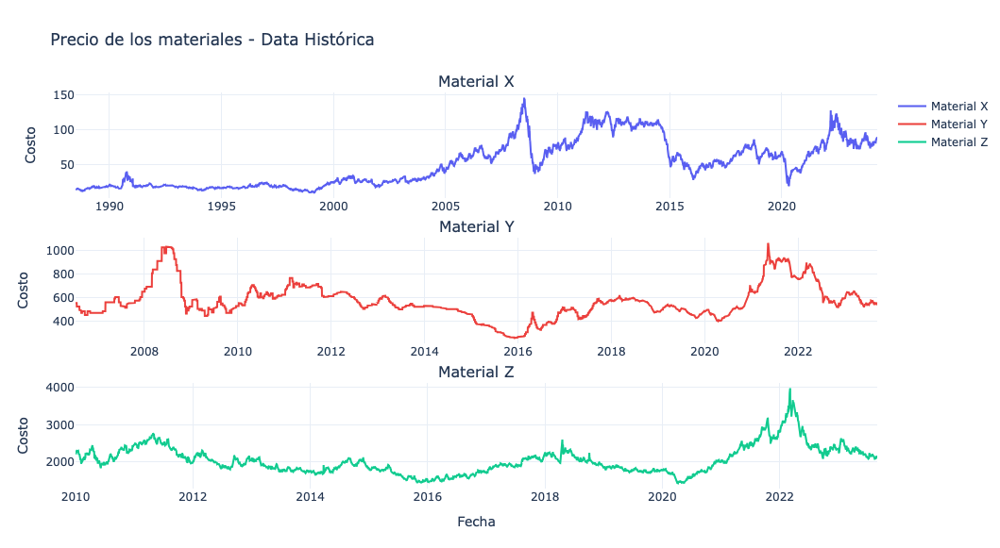
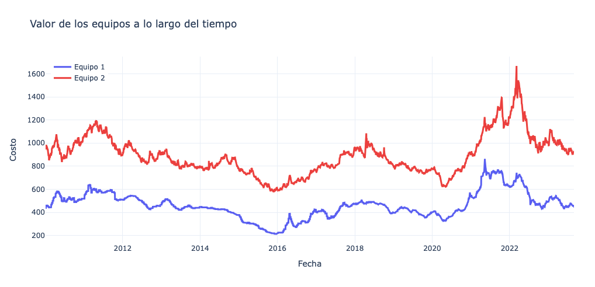
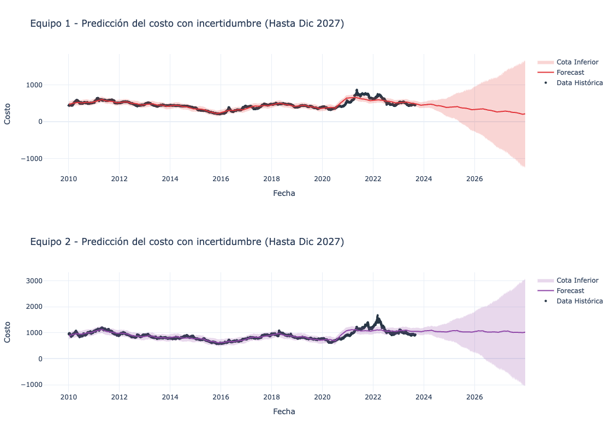
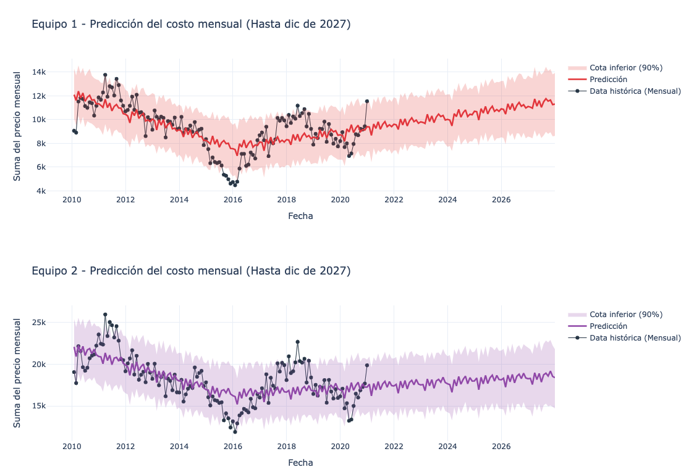

# Cost Estimation Analysis Report

## Problem description

The objective is to estimate the costs associated with acquiring two construction equipment units for a 36-month project. A base price for each equipment unit is derived from the historical prices of three raw materials (X, Y, Z). Time series data for these materials is available, and the task is to forecast equipment costs for the project duration.

## Assumptions

Several assumptions were necessary due to gaps in the problem specification:

- Equipment cost is modeled as a **daily rental rate**, so the total cost over the project period is the sum of daily base prices over 36 months. Alternative models (e.g., monthly averages, single fixed payment) were considered and set aside.
- The project execution years are assumed to be **2025, 2026, and 2027**.
- The deliverable is the cost estimate itself — no need to expose prediction endpoints or automate pipelines for recurring use cases.

## Methodology

### Forecasting approach

Given the requirement to forecast equipment costs for the next 3 years, the natural framing is a time series forecasting problem. Two possible approaches were considered:

1. **Forecast each material (X, Y, Z) individually**, then compute equipment base prices from the forecasted material values. This allows analysis of individual material trends but compounds uncertainty across multiple forecasts.
2. **Compute historical base prices first, then forecast the equipment series directly.** With sufficient overlapping historical data across all three materials (3,530 coincident dates between 2010–2023), this approach was preferred — it minimizes compounded uncertainty and keeps the focus on the final quantity of interest.

### Model selection

Several forecasting approaches were considered:

- **Simple baselines** (mean, moving average) — appropriate first steps for establishing a reference point.
- **SARIMA** — classical statistical model capturing trend and seasonality.
- **LSTM / XGBoost** — machine learning regressors that learn from lagged values.
- **Prophet** (selected) — handles trend, seasonality, and changepoints out of the box, with a clean API well-suited for an initial exploration.

### Time scale

An initial fit at daily resolution produced confidence intervals that expanded explosively over the 3-year forecast horizon (lower bounds approaching negative values). Aggregating to monthly resolution — summing daily prices per month — significantly improved interval behavior while retaining enough data points for a stable fit.

The COVID-19 period (2020–2022) was identified as an anomalous regime with atypical price behavior and excluded from model fitting.

## Results

### Exploratory data analysis

The three material series span multiple years at daily resolution, showing non-linear behavior, local peaks, and the anomalous COVID-19 period.

The overlapping date range across all three materials is 2010–2023 (3,530 coincident observations), used to compute historical equipment base prices:

### Daily-scale forecast (initial attempt)

A first Prophet fit at daily resolution:

Confidence intervals explode over the 3-year horizon — a known limitation of long-horizon forecasting. This motivated the switch to monthly aggregation.

### Monthly-scale forecast (final)

After aggregating to monthly resolution and excluding the COVID-19 period:

Intervals are well-bounded and show a plausible slightly-upward trend. These forecasts were used to compute the final cost estimates.

### Cost estimates

**Equipment 1 — 3-year total (2025–2027):**

| Scenario | Cost |
|---|---|
| Base | $398,237.80 |
| Optimistic (lower bound) | $309,725.27 |
| Pessimistic (upper bound) | $486,177.13 |

**Equipment 2 — 3-year total (2025–2027):**

| Scenario | Cost |
|---|---|
| Base | $659,765.24 |
| Optimistic (lower bound) | $531,410.41 |
| Pessimistic (upper bound) | $786,732.04 |

Per-year breakdowns are available in `notebooks/02_forecasting.ipynb`.

## Potential improvements

**EDA:**
- Cross-series correlation analysis between materials
- Autocorrelation and seasonality decomposition at monthly resolution
- Explicit stationarity tests before model selection

**Forecasting:**
- Benchmark against a simple mean baseline to quantify model value-add
- Add a COVID-19 regressor instead of exclusion, to make use of the full dataset
- Evaluate on a held-out test set (train/test split) with RMSE
- Compare against SARIMA and tree-based regressors (XGBoost, LightGBM)
- Explore forecasting on individual material series, some of which extend further back (X available from 1988), to assess whether additional history improves accuracy

**Code:**
- Modularize preprocessing and forecasting steps into reusable utilities for recurring analyses of this type
